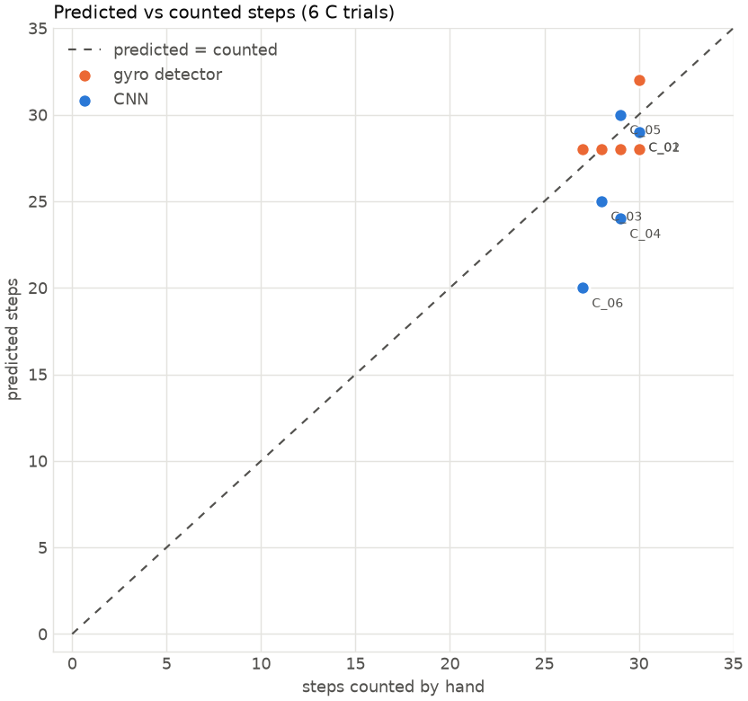
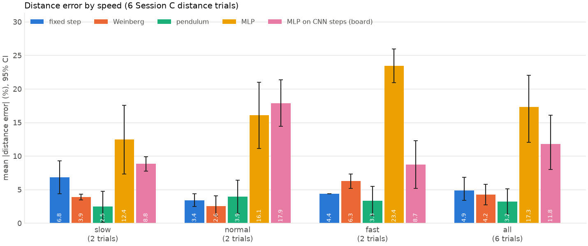
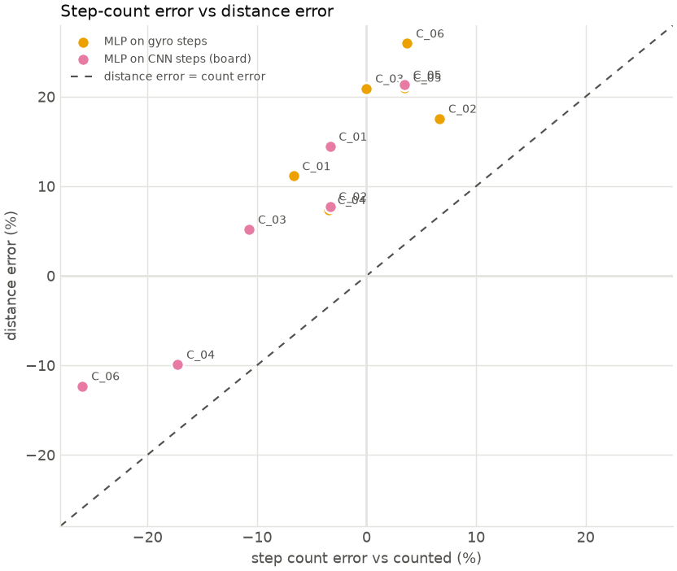

# Results: uncertainty analysis

Made by `python analysis/evaluate.py --test C`. **Test set: Session C, the held-out test set (never used in training or model selection).**
Trials: C_01, C_02, C_03, C_04, C_05, C_06. Confidence intervals (CI) are 95% bootstrap intervals over trials: with 2-4 trials per speed they are wide, and say how much a handful of trials can't pin down.

## 1. Step count

Over all 6 test trials (173 steps counted by hand), the CNN was off by **3.00 steps per trial** on average (95% CI 1.33 to 5.00), and the gyro stride detector by **1.17** (95% CI 0.67 to 1.67). Bias (average of predicted − counted): CNN -2.67 steps, gyro +0.17. A negative bias means steps are missed.

The CNN's steps are counted with the rule chosen on the training trials only (`analysis/counting_rule.md`). It counts the peaks of the CNN output, plus one step at the start or end of a walk when the gyro stride detector has a step there that the CNN missed. The CNN nearly always misses the last step of a walk: its output there is ~0, not a weak peak. With the old peaks-only rule the CNN was off by 6.83 steps per trial (bias -6.83). The plain sum of its output (what the count loss trains) is off by 6.75.

On these straight walks the plain gyro detector counts more accurately than the CNN. The agreement is partly by construction: the edge steps come from the gyro detector. The CNN still decides every step inside a walk and whether there is a walk at all (it counts sitting down as 0, where the gyro detector counts a stride).

Per trial:

| trial | speed | counted | CNN | CNN, old rule | CNN sum of output | gyro detector | CNN, IMU only (ablation) |
|---|---|---|---|---|---|---|---|
| C_01 | normal | 30 | 29 | 28 | 27.40 | 28 | 29 |
| C_02 | slow | 30 | 29 | 16 | 18.30 | 32 | 31 |
| C_03 | fast | 28 | 25 | 24 | 21.90 | 28 | 28 |
| C_04 | slow | 29 | 24 | 20 | 21.80 | 28 | 29 |
| C_05 | normal | 29 | 30 | 29 | 29.70 | 30 | 31 |
| C_06 | fast | 27 | 20 | 15 | 14.80 | 28 | 20 |

By speed:

| speed | method | trials | steps counted | mean abs error (steps) | 95% CI | bias (steps) | bias 95% CI | SD (steps) | total error % |
|---|---|---|---|---|---|---|---|---|---|
| slow | CNN | 2 | 59 | 3.00 | 1.00 to 5.00 | -3.00 | -5.00 to -1.00 | 2.83 | -10.17 |
| slow | CNN, old rule (peaks only) | 2 | 59 | 11.50 | 9.00 to 14.00 | -11.50 | -14.00 to -9.00 | 3.54 | -38.98 |
| slow | gyro detector | 2 | 59 | 1.50 | 1.00 to 2.00 | 0.50 | -1.00 to 2.00 | 2.12 | 1.69 |
| normal | CNN | 2 | 59 | 1.00 | 1.00 to 1.00 | 0.00 | -1.00 to 1.00 | 1.41 | 0.00 |
| normal | CNN, old rule (peaks only) | 2 | 59 | 1.00 | 0.00 to 2.00 | -1.00 | -2.00 to 0.00 | 1.41 | -3.39 |
| normal | gyro detector | 2 | 59 | 1.50 | 1.00 to 2.00 | -0.50 | -2.00 to 1.00 | 2.12 | -1.69 |
| fast | CNN | 2 | 55 | 5.00 | 3.00 to 7.00 | -5.00 | -7.00 to -3.00 | 2.83 | -18.18 |
| fast | CNN, old rule (peaks only) | 2 | 55 | 8.00 | 4.00 to 12.00 | -8.00 | -12.00 to -4.00 | 5.66 | -29.09 |
| fast | gyro detector | 2 | 55 | 0.50 | 0.00 to 1.00 | 0.50 | 0.00 to 1.00 | 0.71 | 1.82 |
| all | CNN | 6 | 173 | 3.00 | 1.33 to 5.00 | -2.67 | -5.00 to -0.67 | 2.94 | -9.25 |
| all | CNN, old rule (peaks only) | 6 | 173 | 6.83 | 2.83 to 11.00 | -6.83 | -11.00 to -2.83 | 5.67 | -23.70 |
| all | gyro detector | 6 | 173 | 1.17 | 0.67 to 1.67 | 0.17 | -0.84 to 1.17 | 1.47 | 0.58 |

## 2. Distance

Data: 6 Session C distance trials, models fitted on all 8 A/B distance trials. Each method predicts a length for every step; the trial's distance is their sum.

Mean distance error: MLP **17.3%** (95% CI 12.0 to 22.1), Weinberg 4.2% (2.7 to 5.8), pendulum 3.2% (1.4 to 5.1), fixed step 4.9% (3.4 to 6.8). On the board the MLP runs on the CNN's steps instead of the gyro detector's: 11.8% (8.0 to 16.1), bias +4.4%.

The intervals of the MLP, Weinberg and pendulum overlap: with this many trials they can't be told apart. A fixed step length is clearly worse at slow and fast speeds, because step length changes with speed.

Per trial (distance error %):

| trial | speed | distance_m | counted | gyro steps | CNN steps | fixed step | Weinberg | pendulum | MLP | MLP on CNN steps (board) |
|---|---|---|---|---|---|---|---|---|---|---|
| C_01 | normal | 23.00 | 30 | 28 | 29 | -4.37 | -1.07 | -6.41 | 11.14 | 14.43 |
| C_02 | slow | 23.00 | 30 | 32 | 29 | 9.29 | 3.47 | 4.76 | 17.54 | 7.76 |
| C_03 | fast | 23.00 | 28 | 28 | 25 | -4.37 | 5.20 | -5.48 | 20.91 | 5.17 |
| C_04 | slow | 23.00 | 29 | 28 | 24 | -4.37 | -4.31 | 0.15 | 7.34 | -9.91 |
| C_05 | normal | 23.00 | 29 | 30 | 30 | 2.46 | 4.06 | -1.44 | 21.00 | 21.33 |
| C_06 | fast | 23.00 | 27 | 28 | 20 | -4.37 | 7.31 | 1.13 | 25.94 | -12.31 |

By speed:

| speed | method | trials | mean abs error % | 95% CI | bias % | bias 95% CI |
|---|---|---|---|---|---|---|
| slow | fixed step | 2 | 6.83 | 4.4 to 9.3 | 2.46 | -4.4 to 9.3 |
| slow | Weinberg | 2 | 3.89 | 3.5 to 4.3 | -0.42 | -4.3 to 3.5 |
| slow | pendulum | 2 | 2.45 | 0.1 to 4.8 | 2.45 | 0.1 to 4.8 |
| slow | MLP | 2 | 12.44 | 7.3 to 17.5 | 12.44 | 7.3 to 17.5 |
| slow | MLP on CNN steps (board) | 2 | 8.83 | 7.8 to 9.9 | -1.08 | -9.9 to 7.8 |
| normal | fixed step | 2 | 3.42 | 2.5 to 4.4 | -0.95 | -4.4 to 2.5 |
| normal | Weinberg | 2 | 2.57 | 1.1 to 4.1 | 1.49 | -1.1 to 4.1 |
| normal | pendulum | 2 | 3.92 | 1.4 to 6.4 | -3.92 | -6.4 to -1.4 |
| normal | MLP | 2 | 16.07 | 11.1 to 21.0 | 16.07 | 11.1 to 21.0 |
| normal | MLP on CNN steps (board) | 2 | 17.88 | 14.4 to 21.3 | 17.88 | 14.4 to 21.3 |
| fast | fixed step | 2 | 4.37 | 4.4 to 4.4 | -4.37 | -4.4 to -4.4 |
| fast | Weinberg | 2 | 6.26 | 5.2 to 7.3 | 6.26 | 5.2 to 7.3 |
| fast | pendulum | 2 | 3.31 | 1.1 to 5.5 | -2.17 | -5.5 to 1.1 |
| fast | MLP | 2 | 23.42 | 20.9 to 25.9 | 23.42 | 20.9 to 25.9 |
| fast | MLP on CNN steps (board) | 2 | 8.74 | 5.2 to 12.3 | -3.57 | -12.3 to 5.2 |
| all | fixed step | 6 | 4.87 | 3.4 to 6.8 | -0.95 | -4.4 to 3.6 |
| all | Weinberg | 6 | 4.24 | 2.7 to 5.8 | 2.44 | -0.9 to 5.4 |
| all | pendulum | 6 | 3.23 | 1.4 to 5.1 | -1.21 | -4.2 to 1.8 |
| all | MLP | 6 | 17.31 | 12.0 to 22.1 | 17.31 | 12.0 to 22.1 |
| all | MLP on CNN steps (board) | 6 | 11.82 | 8.0 to 16.1 | 4.41 | -5.3 to 13.9 |

## 3. Ablation: what the ultrasonic adds

Each variant is trained exactly like the committed model (same split, settings and device), three times with seeds 0, 1, 2; only the inputs change. For the step detector, "IMU only" means the ultrasonic channels are held at "no echo", so it can't use them. Seed 0 with IMU + ultrasonic is the committed model. Training on so few trials is sensitive to the random start, so differences between single runs mean little; look at the spread across seeds.

| model | inputs | mean abs error per seed | mean over seeds |
|---|---|---|---|
| step detector | IMU + ultrasonic | 3.00, 1.67, 4.00 steps | 2.89 steps (total -6.9%) |
| step detector | IMU only | 1.83, 4.00, 1.00 steps | 2.28 steps (total -1.0%) |
| step-length MLP | all 5 features | 17.3, 17.2, 16.9% distance | 17.1% |
| step-length MLP | IMU features only | 6.1, 6.1, 6.1% distance | 6.1% |

Paired difference per test trial, averaged over the seeds (IMU only − IMU + ultrasonic): absolute step error 95% CI -1.44 to 0.11 steps; absolute distance error -14.3 to -6.9 percentage points. A negative value means the variant without the ultrasonic did better; an interval that includes 0 means this data can't tell them apart.

**Step detector:** this data can't tell whether the ultrasonic helps counting.

**Step length:** the ultrasonic features made the distance clearly worse on these trials: without them the error was 6.1% vs 17.1%, lower in every seed, and the whole paired interval (-14.3 to -6.9 points) is below 0. The step-length MLP leans on the ultrasonic features, so a change in the echoes (clothing, sensor aim) carries straight into the step lengths.

## 4. How step-count errors become distance errors

Distance = number of steps × their lengths, so a missed or extra step moves the distance by about one step's share: on a 25-step walk, one extra step is +4%. The table splits each trial's distance error into the count part and what's left ("length-only": the prediction rescaled to the hand-counted number of steps).

| trial | counted | gyro steps | gyro count err % | MLP distance err % | length-only err % | CNN steps | CNN count err % | board (CNN steps) distance err % |
|---|---|---|---|---|---|---|---|---|
| C_01 | 30 | 28 | -6.67 | 11.14 | 19.07 | 29 | -3.33 | 14.43 |
| C_02 | 30 | 32 | 6.67 | 17.54 | 10.20 | 29 | -3.33 | 7.76 |
| C_03 | 28 | 28 | 0.00 | 20.91 | 20.91 | 25 | -10.71 | 5.17 |
| C_04 | 29 | 28 | -3.45 | 7.34 | 11.17 | 24 | -17.24 | -9.91 |
| C_05 | 29 | 30 | 3.45 | 21.00 | 16.97 | 30 | 3.45 | 21.33 |
| C_06 | 27 | 28 | 3.70 | 25.94 | 21.44 | 20 | -25.93 | -12.31 |

Example: C_01 has 28 gyro steps for 30 counted (-6.7%), and its MLP distance error is +11.1%; rescaled to the right step count it would be +19.1%. On the board's path (CNN steps), step-count error and distance error are correlated (r = 0.96 over 6 trials): a step missed by the detector costs distance even if the step lengths are right.

## 5. Limitations

- **Walking only, straight paths only.** All training walks are straight hallway passes at slow, normal and fast speeds (no jogging trials were recorded). In a small room with turns (`bench_05`, 20 steps counted) the CNN found only **15** (the gyro detector 22): turning twists the thigh and breaks up the swing pattern it learned. Stairs, running and turning are not covered.
- **Small dataset.** 14 training and 7 validation trials; 8 distance trials. Per-speed results rest on 2-4 trials, hence the wide intervals; the ablation can only detect large effects.
- **One person, one strap position, one hallway.** Everything was recorded by one person with the sensor just above the knee, mostly in one indoor hallway. Another body, gait, strap position or floor may need recalibration or more data.
- **Hand counts as truth.** Counted steps can be off by one (the first or last step is ambiguous); distances were measured with a tape.
- **Live delay.** On the board a step is counted about 1.5 s after it happens (measured 1.34-1.72 s on the board's clock): the CNN needs 1.2 s of data after each step. The public MQTT broker added another 0.7-4.7 s on the evening it was measured, so the dashboard can lag 2-6 s.
- **Held-out test set.** Session C was never used for training or model selection, so these are honest test numbers. With 6 trials (2 per speed) the intervals are still wide.
