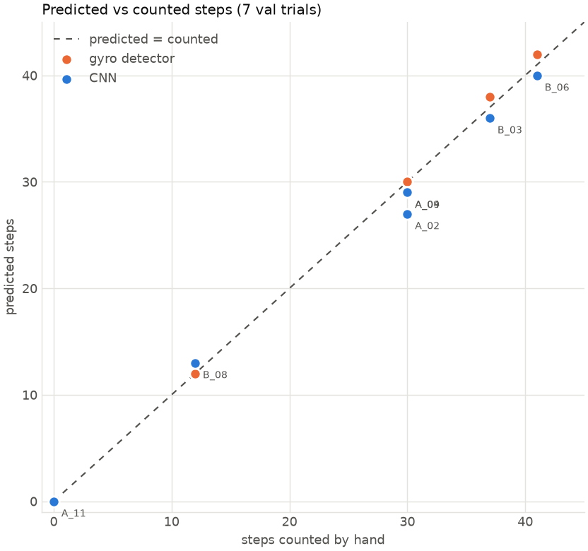
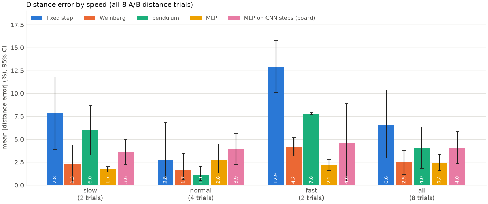
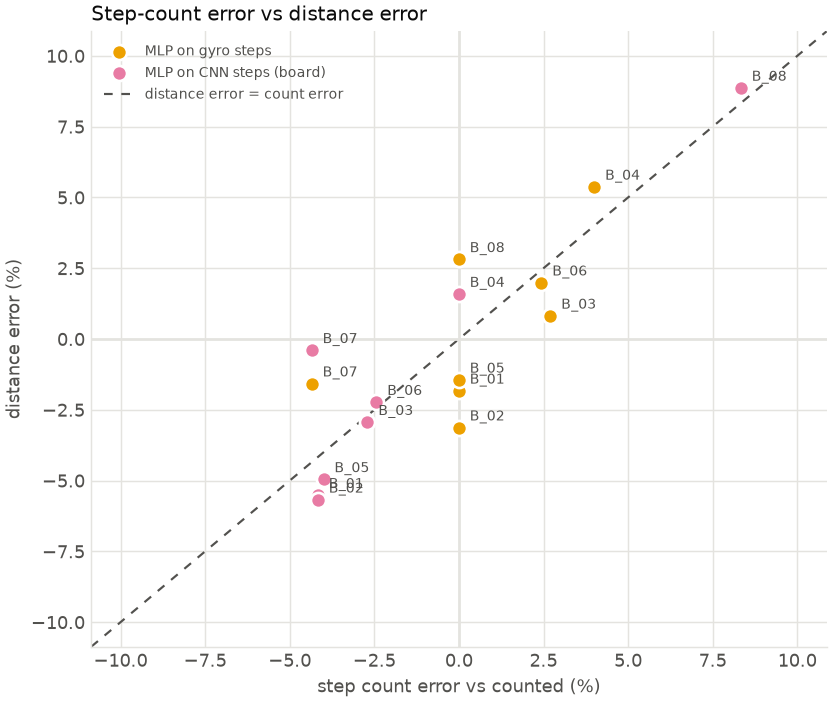

# Results: uncertainty analysis

Made by `python analysis/evaluate.py --test val`. **Test set: VALIDATION trials standing in for the test set (they also chose the kept training epoch, so these numbers are slightly optimistic).**
Trials: A_04, A_09, A_02, A_11, B_08, B_03, B_06. Confidence intervals (CI) are 95% bootstrap intervals over trials: with 2-4 trials per speed they are wide, and say how much a handful of trials can't pin down.

## 1. Step count

Over all 7 test trials (180 steps counted by hand), the CNN was off by **1.14 steps per trial** on average (95% CI 0.57 to 1.86), and the gyro stride detector by **0.29** (95% CI 0.00 to 0.57). Bias (average of predicted − counted): CNN -0.86 steps, gyro +0.29. A negative bias means steps are missed; the CNN tends to miss a weak first or last step of a walk.

The plain sum of the CNN's output (what the count loss trains) is off by 0.39 steps per trial: the network gets the total about right, but a weak step's bump doesn't always reach the 0.5 needed to be counted as a peak. On these straight walks the plain gyro detector counts more accurately than the CNN; the CNN's advantage is ignoring non-steps (it counts sitting down as 0, where the gyro detector counts a stride).

Per trial:

| trial | speed | counted | CNN | CNN sum of output | gyro detector | CNN, IMU only (ablation) |
|---|---|---|---|---|---|---|
| A_04 | fast | 30 | 29 | 30.00 | 30 | 30 |
| A_09 | normal | 30 | 29 | 30.00 | 30 | 30 |
| A_02 | slow | 30 | 27 | 28.80 | 30 | 30 |
| A_11 | normal | 0 | 0 | 0.00 | 0 | 0 |
| B_08 | fast | 12 | 13 | 12.60 | 12 | 12 |
| B_03 | normal | 37 | 36 | 36.30 | 38 | 37 |
| B_06 | slow | 41 | 40 | 41.20 | 42 | 40 |

By speed:

| speed | method | trials | steps counted | mean abs error (steps) | 95% CI | bias (steps) | bias 95% CI | SD (steps) | total error % |
|---|---|---|---|---|---|---|---|---|---|
| slow | CNN | 2 | 71 | 2.00 | 1.00 to 3.00 | -2.00 | -3.00 to -1.00 | 1.41 | -5.63 |
| slow | gyro detector | 2 | 71 | 0.50 | 0.00 to 1.00 | 0.50 | 0.00 to 1.00 | 0.71 | 1.41 |
| normal | CNN | 2 | 67 | 1.00 | 1.00 to 1.00 | -1.00 | -1.00 to -1.00 | 0.00 | -2.99 |
| normal | gyro detector | 2 | 67 | 0.50 | 0.00 to 1.00 | 0.50 | 0.00 to 1.00 | 0.71 | 1.49 |
| fast | CNN | 2 | 42 | 1.00 | 1.00 to 1.00 | 0.00 | -1.00 to 1.00 | 1.41 | 0.00 |
| fast | gyro detector | 2 | 42 | 0.00 | 0.00 to 0.00 | 0.00 | 0.00 to 0.00 | 0.00 | 0.00 |
| standing (0 steps) | CNN | 1 | 0 | 0.00 | n/a | 0.00 | n/a |  |  |
| standing (0 steps) | gyro detector | 1 | 0 | 0.00 | n/a | 0.00 | n/a |  |  |
| all | CNN | 7 | 180 | 1.14 | 0.57 to 1.86 | -0.86 | -1.71 to 0.00 | 1.21 | -3.33 |
| all | gyro detector | 7 | 180 | 0.29 | 0.00 to 0.57 | 0.29 | 0.00 to 0.57 | 0.49 | 1.11 |

## 2. Distance

Data: all 8 A/B distance trials, each predicted by models fitted on the other 7 (leave-one-trial-out). Each method predicts a length for every step; the trial's distance is their sum.

The step-length models never saw the trial they predict, but the CNN (used for "MLP on CNN steps") was trained on some of these walks, so that column is optimistic for them.

Mean distance error: MLP **2.4%** (95% CI 1.6 to 3.4), Weinberg 2.5% (1.1 to 3.8), pendulum 4.0% (1.8 to 6.3), fixed step 6.6% (3.0 to 10.4). On the board the MLP runs on the CNN's steps instead of the gyro detector's: 4.0% (2.3 to 5.8), bias -1.4%.

The intervals of the MLP, Weinberg and pendulum overlap: with this many trials they can't be told apart. A fixed step length is clearly worse at slow and fast speeds, because step length changes with speed.

Per trial (distance error %):

| trial | speed | distance_m | counted | gyro steps | CNN steps | fixed step | Weinberg | pendulum | MLP | MLP on CNN steps (board) |
|---|---|---|---|---|---|---|---|---|---|---|
| B_01 | normal | 19.00 | 24 | 24 | 23 | -0.88 | -1.14 | 2.40 | -1.83 | -5.52 |
| B_02 | normal | 19.00 | 24 | 24 | 23 | -0.88 | 0.53 | -1.13 | -3.13 | -5.68 |
| B_03 | normal | 30.00 | 37 | 38 | 36 | -0.57 | -0.60 | 0.82 | 0.82 | -2.94 |
| B_04 | normal | 19.00 | 25 | 26 | 25 | 8.77 | 4.43 | 0.23 | 5.37 | 1.59 |
| B_05 | slow | 19.00 | 25 | 25 | 24 | 3.88 | 0.25 | 3.27 | -1.45 | -4.96 |
| B_06 | slow | 30.00 | 41 | 42 | 40 | 11.77 | 4.37 | 8.66 | 1.99 | -2.23 |
| B_07 | fast | 19.00 | 23 | 22 | 22 | -10.09 | -3.16 | -7.72 | -1.58 | -0.40 |
| B_08 | fast | 11.00 | 12 | 12 | 13 | -15.76 | -5.17 | -7.90 | 2.81 | 8.87 |

By speed:

| speed | method | trials | mean abs error % | 95% CI | bias % | bias 95% CI |
|---|---|---|---|---|---|---|
| slow | fixed step | 2 | 7.83 | 3.9 to 11.8 | 7.83 | 3.9 to 11.8 |
| slow | Weinberg | 2 | 2.31 | 0.3 to 4.4 | 2.31 | 0.3 to 4.4 |
| slow | pendulum | 2 | 5.97 | 3.3 to 8.7 | 5.97 | 3.3 to 8.7 |
| slow | MLP | 2 | 1.72 | 1.4 to 2.0 | 0.27 | -1.4 to 2.0 |
| slow | MLP on CNN steps (board) | 2 | 3.59 | 2.2 to 5.0 | -3.59 | -5.0 to -2.2 |
| normal | fixed step | 4 | 2.78 | 0.6 to 6.8 | 1.61 | -0.9 to 6.4 |
| normal | Weinberg | 4 | 1.68 | 0.6 to 3.5 | 0.80 | -0.9 to 3.2 |
| normal | pendulum | 4 | 1.14 | 0.5 to 2.0 | 0.58 | -0.6 to 1.9 |
| normal | MLP | 4 | 2.79 | 1.3 to 4.5 | 0.31 | -2.5 to 3.6 |
| normal | MLP on CNN steps (board) | 4 | 3.93 | 2.3 to 5.6 | -3.14 | -5.6 to -0.2 |
| fast | fixed step | 2 | 12.92 | 10.1 to 15.8 | -12.92 | -15.8 to -10.1 |
| fast | Weinberg | 2 | 4.16 | 3.2 to 5.2 | -4.16 | -5.2 to -3.2 |
| fast | pendulum | 2 | 7.81 | 7.7 to 7.9 | -7.81 | -7.9 to -7.7 |
| fast | MLP | 2 | 2.19 | 1.6 to 2.8 | 0.62 | -1.6 to 2.8 |
| fast | MLP on CNN steps (board) | 2 | 4.63 | 0.4 to 8.9 | 4.23 | -0.4 to 8.9 |
| all | fixed step | 8 | 6.57 | 3.0 to 10.4 | -0.47 | -6.4 to 5.3 |
| all | Weinberg | 8 | 2.46 | 1.1 to 3.8 | -0.06 | -2.2 to 2.1 |
| all | pendulum | 8 | 4.02 | 1.8 to 6.3 | -0.17 | -3.8 to 3.3 |
| all | MLP | 8 | 2.37 | 1.6 to 3.4 | 0.38 | -1.4 to 2.3 |
| all | MLP on CNN steps (board) | 8 | 4.02 | 2.3 to 5.8 | -1.41 | -4.2 to 2.0 |

## 3. Ablation: what the ultrasonic adds

Each variant is trained exactly like the committed model (same split, settings and device), three times with seeds 0, 1, 2; only the inputs change. For the step detector, "IMU only" means the ultrasonic channels are held at "no echo", so it can't use them. Seed 0 with IMU + ultrasonic is the committed model. Training on so few trials is sensitive to the random start, so differences between single runs mean little; look at the spread across seeds.

| model | inputs | mean abs error per seed | mean over seeds |
|---|---|---|---|
| step detector | IMU + ultrasonic | 1.14, 0.14, 1.14 steps | 0.81 steps (total -2.4%) |
| step detector | IMU only | 0.14, 0.57, 0.43 steps | 0.38 steps (total -1.5%) |
| step-length MLP | all 5 features | 2.4, 2.3, 2.4% distance | 2.4% |
| step-length MLP | IMU features only | 3.7, 3.8, 3.9% distance | 3.8% |

Paired difference per test trial, averaged over the seeds (IMU only − IMU + ultrasonic): absolute step error 95% CI -0.76 to -0.14 steps; absolute distance error -0.2 to 3.1 percentage points. A negative value means the variant without the ultrasonic did better; an interval that includes 0 means this data can't tell them apart.

**Step detector:** on these trials it counted slightly better *without* the ultrasonic. The seeds vary as much as the variants do (one run of each is as good as the other's best), and these validation trials also chose the kept epoch, so this is weak evidence: the ultrasonic does not clearly help counting straight walks, where the gyro swing alone is a strong signal. Session C will say more.

**Step length:** without the ultrasonic features the distance error was higher in every seed (3.8% vs 2.4%), but the paired interval (-0.2 to 3.1 points) just includes 0: with this few trials that is suggestive, not proven.

## 4. How step-count errors become distance errors

Distance = number of steps × their lengths, so a missed or extra step moves the distance by about one step's share: on a 25-step walk, one extra step is +4%. The table splits each trial's distance error into the count part and what's left ("length-only": the prediction rescaled to the hand-counted number of steps).

| trial | counted | gyro steps | gyro count err % | MLP distance err % | length-only err % | CNN steps | CNN count err % | board (CNN steps) distance err % |
|---|---|---|---|---|---|---|---|---|
| B_01 | 24 | 24 | 0.00 | -1.83 | -1.83 | 23 | -4.17 | -5.52 |
| B_02 | 24 | 24 | 0.00 | -3.13 | -3.13 | 23 | -4.17 | -5.68 |
| B_03 | 37 | 38 | 2.70 | 0.82 | -1.84 | 36 | -2.70 | -2.94 |
| B_04 | 25 | 26 | 4.00 | 5.37 | 1.32 | 25 | 0.00 | 1.59 |
| B_05 | 25 | 25 | 0.00 | -1.45 | -1.45 | 24 | -4.00 | -4.96 |
| B_06 | 41 | 42 | 2.44 | 1.99 | -0.44 | 40 | -2.44 | -2.23 |
| B_07 | 23 | 22 | -4.35 | -1.58 | 2.90 | 22 | -4.35 | -0.40 |
| B_08 | 12 | 12 | 0.00 | 2.81 | 2.81 | 13 | 8.33 | 8.87 |

Example: B_04 has 26 gyro steps for 25 counted (+4.0%), and its MLP distance error is +5.4%; rescaled to the right step count it would be +1.3%. On the board's path (CNN steps), step-count error and distance error are correlated (r = 0.93 over 8 trials): a step missed by the detector costs distance even if the step lengths are right.

## 5. Limitations

- **Walking only, straight paths only.** All training walks are straight hallway passes at slow, normal and fast speeds (no jogging trials were recorded). In a small room with turns (`bench_05`, 20 steps counted) the CNN found only **10** (the gyro detector 22): turning twists the thigh and breaks up the swing pattern it learned. Stairs, running and turning are not covered.
- **Small dataset.** 14 training and 7 validation trials; 8 distance trials. Per-speed results rest on 2-4 trials, hence the wide intervals; the ablation can only detect large effects.
- **One person, one strap position, one hallway.** Everything was recorded by one person with the sensor just above the knee, mostly in one indoor hallway. Another body, gait, strap position or floor may need recalibration or more data.
- **Hand counts as truth.** Counted steps can be off by one (the first or last step is ambiguous); distances were measured with a tape.
- **Live delay.** On the board a step is counted about 1.5 s after it happens (measured 1.34-1.72 s on the board's clock): the CNN needs 1.2 s of data after each step. The public MQTT broker added another 0.7-4.7 s on the evening it was measured, so the dashboard can lag 2-6 s.
- **Validation as a stand-in.** These numbers use the validation trials, which also picked the kept training epoch: expect Session C to be somewhat worse.
