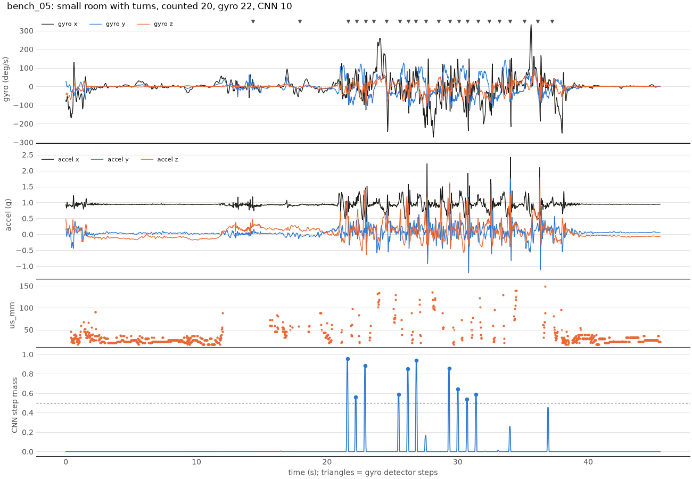

# The CNN step detector

Code: [`training/step_detector/`](../training/step_detector/). Run:

```bash
python scripts/make_sim_dataset.py                                   # fake trials -> data/sim/
python training/step_detector/train.py                               # train + evaluate on them
python training/step_detector/train.py --data-dir data/raw           # the same on real trials
python training/step_detector/test_step_detector.py                  # checks
```

The goal is to count steps from the thigh IMU and the ultrasonic sensor. The
only label is the number of steps counted by hand for each whole trial. Nobody
marks when each step happened.

## 1. What goes in

Each trial is the board's recording at 50 Hz, 8 numbers per sample:

| Channel | What it is |
| --- | --- |
| `ax, ay, az` | acceleration in g, thigh frame (x along the thigh, y to the right, z forward) |
| `gx, gy, gz` | rotation rate in deg/s; `gy` is the thigh swinging forward (+) and back (−) |
| `us_mm` | ultrasonic distance to the other thigh, **clipped at 150 mm** |
| `us_hit` | 1 if there was an echo closer than 150 mm, else 0 |

Before the model sees a trial ([`data.py`](../training/step_detector/data.py)):

1. **Despike:** a single-sample I2C glitch is replaced by the average of its
   neighbours.
2. **Line up the ultrasonic:** the sketch logs each ping's result one row
   late (`us_lag_samples: 1`), so it is moved back one row.
3. **Clip the ultrasonic:** the other thigh is 16–100 mm away. Anything
   farther is a wall or furniture and depends on the room, so it becomes
   "no echo".
4. **z-score:** each channel minus its mean, divided by its standard deviation.
   The means and standard deviations come from the **training trials only**
   and are saved in `norm.json`, so new data gets exactly the same scaling.

`bench_*` trials are hardware checks and are always skipped. Trials are split
whole: sessions A and B train and validate, and session C is only ever the
test set. That way no part of a test trial is ever used for training.

## 2. The network, layer by layer

[`model.py`](../training/step_detector/model.py), 17,401 weights:

```
8 channels ─ Conv1d k9 d1 ─ ReLU ─ Conv1d k9 d2 ─ ReLU ─ Conv1d k9 d4 ─ ReLU ─ Conv1d k9 d8 ─ ReLU ─ 1×1 Conv ─ sigmoid ─ 1 value per sample
              24 filters          24 filters          24 filters          24 filters
```

- **Conv1d, kernel 9.** A filter is a set of 9 weights per input channel
  that slides along time. At every sample it multiplies the 9 samples under it
  by its weights and adds them up, so it measures how much the signal there
  looks like the filter's pattern. Each layer has 24 filters, so it describes
  every sample with 24 numbers. The first layer learns simple shapes, like
  "gy is rising fast" or "an accel spike". Later layers combine those into
  bigger patterns.
- **Dilation 1, 2, 4, 8.** In layer 2 the 9 taps are 2 samples apart, in
  layer 3 they're 4 apart, and in layer 4 they're 8 apart. Each layer sees twice as far
  back and forward as the one before for the same number of weights. Stacked,
  one output sample is affected by 121 input samples (2.4 s), which is
  longer than a stride. That's enough to see a whole swing of this leg and
  infer when the other leg must have landed.
- **"Same" padding.** Each layer pads the ends so its output is exactly as
  long as its input: one output per input sample, for any trial length.
- **ReLU.** It keeps positive values and sets negative ones to 0. Without it,
  four stacked convolutions would collapse into one big linear filter. With
  it, the network can say things like "a swing peak AND then a heel-strike
  spike".
- **1×1 convolution + sigmoid.** At every sample, a weighted sum of the 24
  features gives one score, and the sigmoid squashes it into 0..1. This is
  the step output.

No pooling and no dense layer means the network is **fully convolutional**.
The same weights run everywhere, the trial can be any length, and on the board
it could run on a rolling buffer of the last few seconds.

### What the output means

The output is a **step mass**. Each step should put a total of about 1
into one short bump (at most 100 ms wide), and nothing anywhere else. Then:

- **sum count:** add up the whole output.
- **peak count:** take the 100 ms moving sum of the output and count peaks
  above 0.5 that are at least 0.25 s apart. People don't take two steps in
  0.25 s; jogging is about 0.38 s per step.

The peaks are counted on the 100 ms sum, not on single samples. The model
places a step to within a sample or two, so a step's mass is usually spread
over 3–5 samples, each below 0.5. Their sum is about 1.

## 3. The count loss

[`losses.py`](../training/step_detector/losses.py). For each trial:

> count loss = (sum of the outputs − counted_steps)²

That's the squared difference between how many steps the model added up and
how many you counted. It's zero when they agree, and it grows quickly when they
don't: off by 3 costs 9, off by 10 costs 100. It says nothing about *where*
the steps are, only how many. That's all the label tells us, and it's also why
the count loss alone isn't enough (see 4 and 5).

### The peak penalty

The count loss can be satisfied in useless ways, and training on it found
two of them:

1. **A flat "step rate".** Output a low, nearly constant value while walking
   (cadence ÷ 50 per sample). It adds up to the right count, but there are no
   steps to count. It's the easiest solution, so training found it first.
2. **One leg only.** Put two steps' worth on each step of the leg the sensor
   is on, and nothing on the other leg's. The sum is right, but the peak count
   is half.

The penalty has a term for each. Both are zero for a clean output:

- **spread:** in every 0.25 s window, the output that is *not* within 100 ms
  of the window's biggest bump. A flat rate is mostly spread, so it costs a
  lot.
- **crowding:** (output in a 0.25 s window − 1)², wherever it's more than 1.
  Two steps can't fit in 0.25 s.

It's added with weight 1. That's small next to the count loss at the start
of training (thousands), and it matters once the count is nearly right.

## 4. Why the warm start helps

Before training on counts, the network spends 15 epochs learning from
**pseudo-labels**: step times guessed by the plain gyro detector
([`strides.py`](../training/step_detector/strides.py)).

- That detector finds this leg's forward swing (the big positive `gy` peak).
- It puts this leg's heel strike where `gy` crosses zero after the swing.
- It puts the other leg's heel strike half a stride later.

The warm-start target is 0.2 on each of the 5 samples (100 ms) around every
guessed step, adding up to 1 per step, and 0 elsewhere. The loss is
cross-entropy, weighted so the rare step samples count more.

It helps because the count loss only says how many steps there were, not
where. Starting from random weights, the network has to discover that a step
is "the moment after the thigh swings forward" from totals alone. On the
simulated data it got the counts roughly right but put the steps in the wrong
places:

| | Validation count error (steps per trial) | Step timing F1 |
| --- | --- | --- |
| with warm start | 0.8 | 0.98 |
| no warm start | 1.5–2.6 | 0.66 |

The warm start hands the network the "where" from the gyro detector. The
count loss then only corrects the "how many": steps the gyro detector gets
wrong, such as sitting down, which it counts as a stride, or the first and
last steps.

Two details matter, and both were learned by getting them wrong first:

- **Target 0.2 across 100 ms, not 1 at one sample.** With a target of 1, the
  outputs saturate near 1 over several samples, about 3.7× too much mass per
  step. The count loss then has to remove that, and it does so by first
  killing the weaker leg's steps (problem 2 above).
- **A 10× smaller learning rate for fine-tuning (3e-4), and gradient
  clipping.** The first fine-tune updates are big: Adam moves every weight
  by about the learning rate at once. At 1e-3 that alone wiped out every peak
  within a few batches.

## 5. How backprop updates the weights

One fine-tune step, for a batch of 8 trials:

1. **Forward pass.** Run the trials through the network to get the output
   for every sample.
2. **Loss.** Count loss plus the peak penalty: one number for how wrong the
   batch is.
3. **Backward pass (backprop).** For every one of the 17,401 weights, work
   out how much the loss would change if that weight were nudged up a
   little: the gradient. It's done with the chain rule, from the loss back
   through the sigmoid, the 1×1 conv, each ReLU and each convolution, so one
   pass gives all 17,401 gradients. For the count loss, the gradient at every
   output sample is 2 × (sum − counted). If the trial is over-counted, every
   sample is pushed down, and most where the sigmoid is least saturated.
4. **Clip.** If the gradients together are larger than 1 (their length as one
   vector), scale them down. This keeps one very wrong batch from wrecking
   the network.
5. **Update (Adam).** Move each weight a small step against its gradient.
   Adam keeps a running average of each weight's gradient and of its size,
   so weights with steady gradients move steadily and noisy ones move
   cautiously.

An **epoch** is one pass over all training trials. After each epoch the
model counts the **validation** trials. Training stops when the validation
count error hasn't improved for 80 epochs, and the best epoch's weights are
kept. The test trials (session C) are only used once, at the end.

## 6. Results so far (simulated data only)

The simulator ([`training/simulator.py`](../training/simulator.py)) is built
from two real trials (bench_04, A_01). It has realistic stride shapes,
heel-strike scatter, ultrasonic bursts, room clutter, strap offsets and
miscounts, but it is much cleaner and more regular than real walking. These
numbers show the **pipeline works**. They don't predict accuracy on real
data. See `models/step_detector/sim/results.md` for the full table.

| Test set (session C, 9 trials, 446 steps) | Count error per trial | Total | Step timing F1 |
| --- | --- | --- | --- |
| gyro detector alone | 0.89 | −0.4% | 0.986 |
| CNN, peak count | 0.56 | −0.7% | 0.981 |
| CNN, sum | 0.99 | −0.9% | — |

- **On simulated walking the CNN is only slightly better than the gyro
  detector.** The simulator's steps are tied exactly to the gyro waveform it
  plays back, so the gyro detector is nearly perfect there and there is
  little to gain.
- **Where the CNN beat it was sitting down.** Both sit-down trials count 2
  "steps" for the gyro detector and 0 for the CNN, because the count loss saw
  counted_steps = 0.
- **Real data will tell whether the CNN helps.** Real strides vary much more,
  and the ultrasonic and accelerometer carry information the gyro detector
  ignores.

## 7. First real data (2026-11-03, no session C yet)

```bash
python training/step_detector/train.py --data-dir data/raw
```

There were 21 trials: A_01–A_13 (A_11–A_13 are standing, zero steps) and
B_01–B_08 (tape-measured distances of 11, 19 and 30 m). They were split by whole trial into 14 for training and 7 for
validation. There is no test set yet, so the validation trials also chose
the kept epoch, which makes their numbers slightly optimistic. Session C stays
the final test. Training length is set in updates, not epochs: 14 trials make
only 2 batches per epoch, and at the simulated data's epoch counts the warm
start was too short and fine-tuning stopped before it recovered.

| Validation (7 trials, 180 steps) | Count error per trial | Total |
| --- | --- | --- |
| gyro detector alone | 0.29 | +1.1% |
| CNN, peak count | 1.14 | −3.3% |
| CNN, sum | 0.38 | −0.7% |

The CNN's sum is close to the gyro detector. Its peak count is usually one low:
it misses a weak first or last step. With 14 training trials, these
differences of 1–2 steps are within noise. Full table:
`models/step_detector/real/results.md`; plots:
`docs/figures/step_detector/real/`. Timing F1 is left out because real
trials have no true step times.

## 8. Known limitation: turns and small-room walking

All training data is straight hallway walking (sessions A and B). In a small
room with turns, the detector misses about half the steps.

`bench_05` (2026-11-03, 20 steps counted, small room with turns; a `bench`
trial, so never used for training):

| | Steps |
| --- | --- |
| counted by hand | 20 |
| gyro stride detector | 22 |
| CNN, offline | 10 |
| CNN, live on the board (replayed) | 10 |



- **The live code is not the cause.** The board's live code and the offline
  model find exactly the same 10 steps.
- **The walking looks different.** Turning twists the thigh along its length
  (gyro x, up to ±250 deg/s), and the forward swing (gyro y) is weaker and
  irregular instead of one clean +130 deg/s peak per stride.
- **Only the straight stretches count.** The CNN counts steps on the short
  straight stretches between turns (21.6–22.9 s, 25.5–26.8 s, 29.3–31.4 s)
  and almost nothing through the turns. A lower threshold would recover only
  one step: the largest missed bump is 0.46.

**Fix (not done):** record count trials that include turns and room walking,
keep some for validation, retrain, re-export (`scripts/export_models.py`) and
redeploy. Session C and the demo use straight walks, where the detector was
within 1–2 steps on validation.
