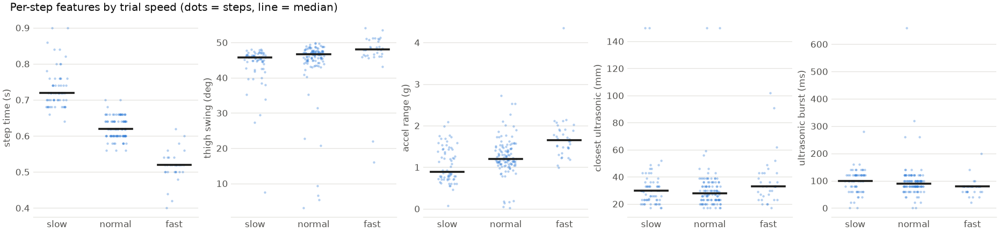
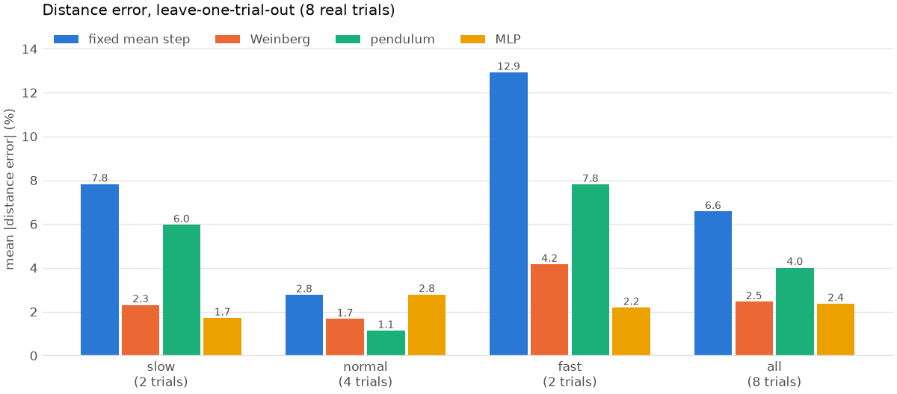

# Step length: how far each step goes

Code: [`training/step_length/`](../training/step_length/). Run:

```bash
python training/step_length/train.py                         # real Session B distance trials (data/raw)
python training/step_length/train.py --leg-length 0.9        # same, with your leg length for the pendulum
python training/step_length/test_step_length.py              # checks
```

Distance walked = the sum of the lengths of the steps. The step detector
counts the steps. This part estimates how long each one is. The only labels
are the Session B trials: you walked a tape-measured distance (11, 19 or
30 m) and saved it with the trial. Nobody measured individual steps.

## 1. From a trial to steps and features

[`features.py`](../training/step_length/features.py) uses the same loading
as the step detector: the board's `BODY_R` frame, despiking, the ultrasonic
lined up and clipped at 150 mm, and `bench_*` trials skipped. Then, for each
distance trial:

1. **Find the steps.** The gyro stride detector finds each forward swing of
   the thigh and puts two steps in every stride. Only the **main walking
   bout** is kept: the longest run of strides without a long pause. That
   way, moving your leg after you've stopped (B_05, about 5 s after the last
   step) doesn't count as part of the walk. Detected steps match your counts
   within ±1 on every trial.
2. **Describe each step** with five numbers:

| Feature | What it measures | Why it might tell step length |
| --- | --- | --- |
| step time (s) | time to the next step | faster steps are usually longer |
| thigh swing (deg) | how far the thigh swings over the stride around this step: `gy` added up over time, with any slow drift removed, max − min | a bigger swing moves the foot further |
| accel range (g) | largest minus smallest acceleration within the step | harder, faster steps jolt more (Weinberg's idea) |
| closest ultrasonic (mm) | how close the thighs come as they pass | stance width / how the legs pass |
| ultrasonic burst (ms) | how long the thighs stay side by side | slower passes take longer |



Step time and accel range change clearly with speed. Swing angle barely
changes, about 46° slow and 48° fast. The ultrasonic features overlap
between speeds.

## 2. The methods

Every method gives each step a length. A trial's predicted distance is the sum
of its step lengths.

- **fixed mean step:** every step is the same length K.
- **Weinberg:** step = K × (accel range)^0.25. This is a classic
  pedometer formula.
- **pendulum:** step = K × 2 L sin(swing / 2). The leg is treated as a
  pendulum of length L swinging through the thigh's swing angle. K is fitted,
  so L only changes how K reads, not the predictions.
- **MLP:** a small neural network, below.

All four are fitted the same way, with the same loss, so the comparison is
fair.

## 3. What the MLP does

```
5 features ─ z-score ─ Linear 5→16 ─ ReLU ─ Linear 16→16 ─ ReLU ─ Linear 16→1 ─ softplus ─ step length (m)
```

- **z-score:** each feature minus its mean, divided by its standard
  deviation, using the training trials only. Afterwards step time (about 0.6)
  and ultrasonic burst (about 100) are on the same scale.
- **Linear 5→16:** 16 weighted sums of the 5 features, each with its own
  weights and offset. You can think of each one as a different blend, such
  as "short step time and big accel range".
- **ReLU:** keeps positive values and sets negative ones to 0. This lets the
  network bend: for example, "longer steps when faster, but only up to a
  point".
- **Linear 16→16, ReLU:** combines those 16 blends into 16 new ones.
- **Linear 16→1, softplus:** one number per step. Softplus is a smooth
  version of "max(0, x)", so a step length can never come out negative.

It has 385 weights. It starts out answering "every step is the average
length", because its output bias is set to that. Training only has to learn
how a step differs from average.

## 4. Why a loss on the trial sum works without step labels

For each training trial:

> loss = ((sum of predicted step lengths − measured distance) / measured distance)²

That's the squared fractional error of the whole trial: 2% short costs
0.0004 whether the trial was 11 m or 30 m. It's dividing by the distance that
makes short and long trials count equally.

Nobody told the model how long any one step was, but the trials differ
in *what kind of steps they contain*:

- **Different speeds:** a slow trial is made of slow steps (long step time,
  small accel range) and covers 0.71–0.76 m per step. A fast trial is made of
  fast steps and covers 0.86–0.92 m per step.
- **Only one consistent answer:** the only way to get every trial's total
  right at once is to give slow-looking steps a shorter length and
  fast-looking steps a longer one. The per-step answer is pinned down by
  many trials with different mixes of steps.
- **Backprop:** it carries each trial's error back to every step in it. If
  a trial came out 5% long, every one of its steps is pushed shorter, and
  the weights shift so that steps with similar features get shorter
  everywhere.

The catch is that each trial is one equation. 8 trials give at most 8
constraints, and the MLP has 385 weights. It could fit 8 totals perfectly in
many different ways. Three things keep it from fitting noise:

- it starts from the average step;
- weight decay pulls every weight toward 0;
- training is a fixed 1,500 updates.

In practice, it behaves like a model with only a few effective parameters.

## 5. Evaluation: leave one trial out

There are only 8 trials, so each one in turn is held out. Every method is fitted
on the other 7, including the MLP's z-score stats, and predicts the held-out
trial's distance. All 8 predictions come from models that never saw that
trial.



| Mean distance error | fixed | Weinberg | pendulum | MLP |
| --- | --- | --- | --- | --- |
| slow (2 trials) | 7.8% | 2.3% | 6.0% | 1.7% |
| normal (4) | 2.8% | 1.7% | 1.1% | 2.8% |
| fast (2) | 12.9% | 4.2% | 7.8% | 2.2% |
| **all (8)** | **6.6%** | **2.5%** | **4.0%** | **2.4%** |

The per-trial table is in `models/step_length/real/results.md`. The MLP gives
2.3–2.4% with other random seeds, so the result isn't luck of the start.

## 6. Can 8 trials tell the methods apart?

**Only partly.** A paired bootstrap compares two methods on the same 8 trials:

| Comparison (mean distance error) | Difference | 95% interval | Better on |
| --- | --- | --- | --- |
| MLP vs Weinberg | −0.1 points | −1.3 to +1.1 | 3 of 8 |
| MLP vs pendulum | −1.6 | −4.3 to +1.1 | 5 of 8 |
| MLP vs fixed | −4.2 | −8.0 to −0.8 | 5 of 8 |
| Weinberg vs fixed | −4.1 | −6.7 to −1.6 | 6 of 8 |

- **Clear:** a fixed step length is worse. It's right at normal speed and
  about 8–13% off at slow and fast, because your step length changes with
  speed. Both Weinberg and the MLP fix that.
- **Not clear:** whether the MLP beats Weinberg, or the pendulum. The
  differences are smaller than the trial-to-trial noise. There are only 2
  slow and 2 fast trials, and no jog trials.
- **Shared error:** some of the error isn't step length at all. B_04 has 26
  detected steps for 25 counted, which alone puts every step-count-based
  method about 4% long on that trial.

To separate the MLP from Weinberg you'd need more distance trials,
especially slow, fast and jog, ideally on different days. Session C will be
the first real test.

## 7. Saved

- `models/step_length/real/model.pt`: the MLP fitted on all 8 trials
  (local only, `*.pt` is gitignored).
- `norm.json`: feature means and standard deviations for z-scoring.
- `baselines.json`: the fitted constants on all 8 trials. Fixed step
  0.79 m; Weinberg K, pendulum scale.
- `results.md` / `results.csv`: per-trial predictions and errors.
- figures in `docs/figures/step_length/real/`.
